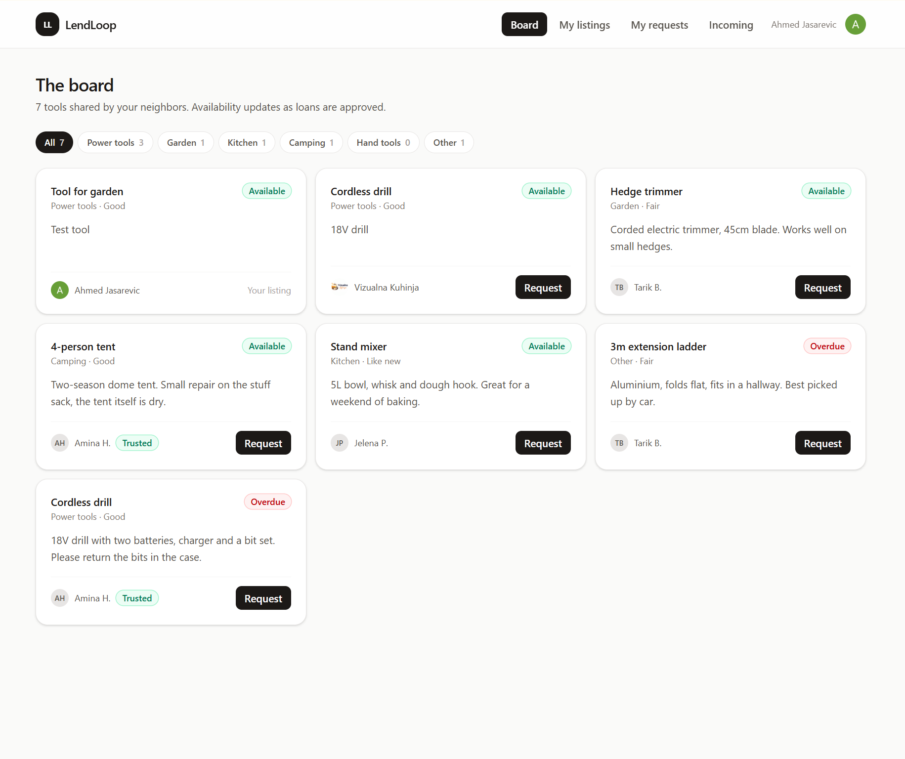
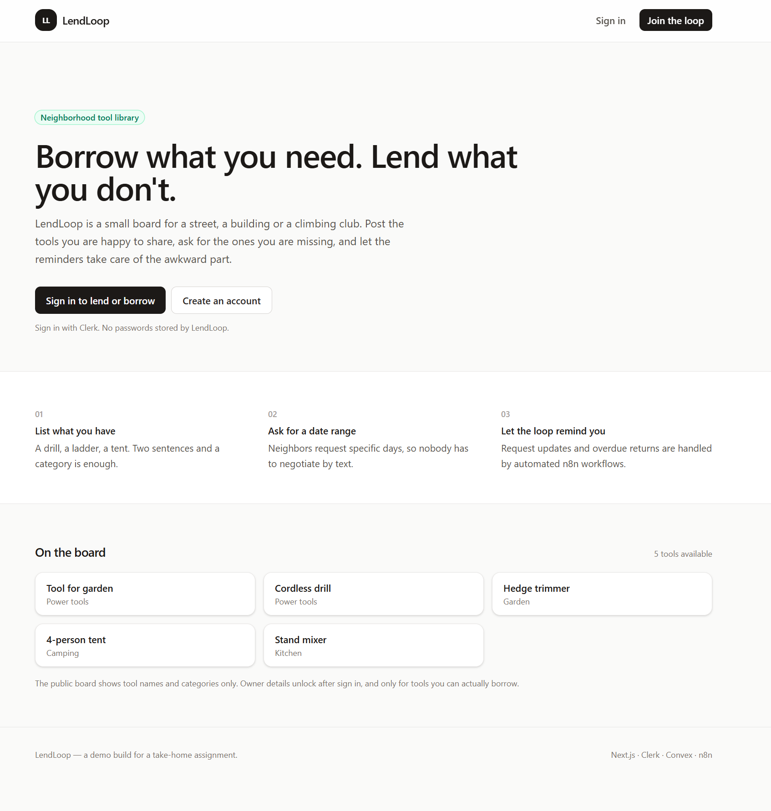

# LendLoop take-home task

A neighborhood tool-lending board: neighbors list tools they are willing to lend, request them
for a date range, and receive automated notifications and overdue reminders handled by n8n.

Built for the Fluence International full-stack take-home. Stack: **Next.js App Router · Clerk ·
Convex · n8n · TypeScript**.

> **Borrow what you need. Lend what you don't.**

---

## Screenshots

Signed-in board — live availability, trust badges, category filter and request actions:



Public landing page — tool names and categories only, no owner details, Clerk CTA:



---

## Table of contents

1. [What it does](#what-it-does)
2. [Architecture](#architecture)
3. [Data model](#data-model)
4. [Authorization model](#authorization-model)
5. [Security decisions](#security-decisions)
6. [n8n automation](#n8n-automation)
7. [Local setup](#local-setup)
8. [Testing](#testing)
9. [Deployment](#deployment-optional)
10. [Production readiness](#production-readiness)
11. [Repository layout](#repository-layout)

---

## What it does

**Public** (`/`)
- LendLoop branding and tagline.
- A read-only board of available tools: **name + category only**, no owner details.
- “Sign in to lend or borrow” via Clerk.

**Signed in**
- `/browse` — all active tools with condition, description, owner, live availability and a
  category filter. Request any tool you do not own for a date range.
- `/listings` — create, edit and soft-remove your own listings. Shows pending request counts.
- `/requests` — everything you asked to borrow, with the automation trail for each loan.
- `/incoming` — requests on your tools: approve, decline, mark returned.
- `/admin` — every loan, every listing, every member; remove listings and mark trusted lenders.

**Automation**
- A request being created or changing status triggers a signed webhook into n8n, which renders
  the notification and posts a signed delivery receipt back into Convex.
- A daily n8n schedule pulls overdue loans from a signed Convex endpoint, “sends” a reminder and
  writes the reminder back idempotently.
- An n8n error workflow reports failures into the same activity feed, so nothing fails silently.

> Delivery in this build is a logged mock (explicitly allowed by the brief). The message is fully
> rendered before the boundary; swapping in Gmail/SMTP/Slack is a one-node change, documented in
> [`n8n/README.md`](n8n/README.md).

---

## Architecture

```
┌────────────────────┐    Clerk JWT ("convex" template)    ┌───────────────────────────────┐
│  Next.js App Router│ ─────────────────────────────────► │  Convex functions             │
│  Server + Client   │ ◄───────────────────────────────── │  • queries / mutations        │
│  Clerk components  │        reactive subscriptions      │  • RBAC + ownership checks    │
└─────────┬──────────┘                                     │  • HTTP actions (signed)      │
          │                                                └───────┬───────────────▲───────┘
          │ encrypts nothing; auth is delegated                    │               │
          │                                      scheduled action  │               │ signed
          │                                                        ▼               │ GET/POST
          │                                              ┌──────────────────┐      │
          │                                              │  n8n              │      │
          │                                              │  1 request notify │──────┘
          │                                              │  2 overdue cron   │
          │                                              │  3 error handler  │
          │                                              └──────────────────┘
```

Key properties:

- **The mutation is never blocked by n8n.** It writes the loan and schedules an action
  (`ctx.scheduler.runAfter(0, …)`). If n8n is down, the user still gets a successful request; the
  delivery is retried and the failure is visible in the loan’s activity feed.
- **Availability is derived, never stored.** It is computed from approved loans at read time, so
  it cannot drift.
- **Two independent signing secrets**, one per direction, so a leaked n8n secret cannot be used to
  forge a Convex webhook (and vice versa).

---

## Data model

| Table | Purpose | Notable fields |
|---|---|---|
| `users` | Provisioned lazily from the Clerk identity | `tokenIdentifier`, `role`, `isTrustedLender`, `email` |
| `tools` | Listings | `ownerId`, `category`, `condition`, `status` (`active` / `removed`), `removedBy` |
| `loans` | Borrow requests and their lifecycle | `toolId`, `ownerId`, `borrowerId`, `startDate`, `endDate`, `status`, `reminderCount` |
| `automationEvents` | Delivery log for every automation hop | `eventId` (idempotency key), `direction`, `type`, `status`, `attempt` |

Loan lifecycle:

```
pending ──approve──► approved ──markReturned──► returned
   │                    │
   ├──decline──► declined
   └──cancel───► cancelled

overdue = approved && endDate < today   (derived, not stored)
```

Dates are `YYYY-MM-DD` strings, validated by round-trip parsing, and ranges are **inclusive**.
Storing calendar dates instead of timestamps removes timezone ambiguity from the overdue
calculation.

---

## Authorization model

Every rule below is enforced **inside Convex functions**. The UI only hides buttons.

| Action | Owner | Borrower | Other signed-in | Admin |
|---|:--:|:--:|:--:|:--:|
| Create listing | ✅ | ✅ | ✅ (their own) | ✅ |
| Edit listing | ✅ | ❌ | ❌ | ❌ |
| Remove listing | ✅ | ❌ | ❌ | ✅ |
| Request a tool | ❌ (own tool) | — | ✅ | ✅ |
| Approve / decline | ✅ | ❌ | ❌ | ❌ |
| Cancel request | ❌ | ✅ | ❌ | ❌ |
| Mark returned | ✅ | ✅ | ❌ | ❌ |
| View all loans | own | own | ❌ | ✅ |
| Mark trusted lender | ❌ | ❌ | ❌ | ✅ |

Implementation:

- `requireViewer()` — reads the Clerk identity, upserts the user row, returns the viewer.
- `requireAdmin()` — same plus `role === "admin"`.
- `assertOwner()` — strict ownership (used for edits and loan decisions).
- `assertOwnerOrAdmin()` — moderation override (used only for removing a listing).
- Admins deliberately **cannot edit** other people’s listings or act on their loans: `remove` is
  the only moderation power, which keeps the audit story simple.

New accounts are promoted to admin only if their email appears in the deployment env var
`ADMIN_EMAILS`. No admin address is committed to the repository.

---

## Security decisions

### 1. Authorization is server-side, twice

`proxy.ts` (Next 16’s middleware) protects `/browse`, `/listings`, `/requests`, `/incoming`,
`/admin` with Clerk. That is a UX gate only. Every Convex query/mutation independently derives the
viewer from the JWT and re-checks ownership — calling a mutation directly with a valid token
cannot bypass a UI rule.

### 2. Different projections for public and private data

`tools.listPublic` returns `{ name, category }` and nothing else. Owner identity, condition,
description and availability live in `tools.listAvailable`, which requires authentication. The
public landing page is therefore genuinely public without leaking the neighbor graph.

`publicUser()` strips email addresses and Clerk identifiers from every cross-user payload.

### 3. Request signing

Both integration directions are signed with HMAC-SHA256 over:

```
<timestamp>
<METHOD>
<path or logical route id>
<sha256(raw body)>
```

- **Both sides derive the same bytes.** The implementation in `convex/lib/hmac.ts` is mirrored in
  `n8n/lib/hmac.js`, and `npm test` proves byte equality against each other *and* Node’s
  `crypto`. This is why the workflows can run on n8n Cloud where `require("crypto")` is not
  guaranteed.
- **Replay bounds.** Timestamps older/newer than 5 minutes are rejected; signatures are compared
  in constant time.
- **Route binding.** Method and path are part of the canonical string, so a signature captured on
  `/automation/events` cannot be replayed against `/automation/overdue`.
- **Logical path for the webhook.** Convex signs the constant `/lendloop/request-event` instead of
  the real URL, because self-hosted n8n (`/webhook/...`) and n8n Cloud may use different prefixes.
  It also means a tunnel URL (ngrok) does not invalidate signatures.
- **Responses are signed too**, so n8n can distinguish a genuine Convex response from a proxy.

### 4. Secrets handling

| Secret | Lives in | Never |
|---|---|---|
| `LENDLOOP_WEBHOOK_SECRET` | Convex deployment env + n8n env/vars | in code, in workflow JSON |
| `LENDLOOP_CALLBACK_SECRET` | Convex deployment env + n8n env/vars | in code, in workflow JSON |
| Clerk / Convex keys | `.env` / `.env.local` (gitignored) | committed |

`n8n/lib/hmac.js` reads them through `llConfig()`, which checks `$env` and then `$vars`.
`npm run validate:n8n` fails the build if an exported workflow contains a long hex string,
credential block, private key or inline password.

### 5. Idempotency

Every automation hop has a deterministic key:

| Hop | Key |
|---|---|
| Convex → n8n | `request:<loanId>:<eventType>` |
| n8n delivery receipt | `delivery:request:<loanId>:<eventType>` |
| Overdue fetch (per loan, per day) | `overdue:<loanId>:YYYY-MM-DD` |
| Overdue delivery receipt | `delivery:overdue:<loanId>:YYYY-MM-DD` |
| Workflow failure | `error:<executionId>` |

The dedupe lookup and the insert happen in **one serializable Convex mutation**, so two concurrent
retries cannot both insert. Retrying an already-delivered event updates the existing row instead of
creating a duplicate — and the loan’s `reminderCount` is incremented exactly once.

### 6. Data minimization in the integration

The n8n payload contains only what the message renders: recipient name + email, tool name, dates,
counterpart display name, link. It **never** contains the free-text note, roles, trusted-lender
flags, or the full user record. The note stays in Convex.

### 7. Soft delete with a real consequence

Removing a listing sets `status: "removed"` and records who did it. Loans keep referencing the
tool, so history and the admin audit view stay intact. Pending requests on a removed tool are
declined in the same mutation and notified through the normal automation path — no one is left
waiting on a tool that no longer exists.

### 8. Input validation and limits

- Enum-validated category/condition, length caps enforced server-side (`2–80` name, `5–500`
  description, `280` note).
- Date ranges must be valid, not in the past, at most 90 days, and non-overlapping with an
  approved loan.
- Max 25 active listings per user.
- Borrowing your own tool is rejected, as is a duplicate pending request for the same range.

### 9. Atomic business rules

Approving a loan runs “find conflicting approved loan” and “patch status” in the same mutation.
Convex mutations are serializable, so two lenders cannot both approve overlapping requests — one
of them gets a clear error instead of a double booking.

---

## n8n automation

Three importable workflows live in [`n8n/`](n8n). They are generated from a single JS source by
`npm run build:n8n`, so the HMAC block is identical everywhere.

### Workflow 1 — Request notifications

```
Webhook (POST /webhook/lendloop/request-event, raw body)
  → Verify signature (HMAC + 5 min window)
  → Signature valid?
      ├─ no  → Stop and Error  (visible failed execution → error workflow)
      └─ yes → Compose and deliver  (renders subject/text, logs the delivery)
                → Build delivery receipt (signed)
                  → POST /automation/events   (idempotent)
```

The webhook responds `202` immediately (`responseMode: onReceived`), so Convex never waits on
rendering or delivery.

### Workflow 2 — Overdue reminders

```
Cron 09:00 UTC
  → Build signed GET  (/automation/overdue?date=YYYY-MM-DD)
  → HTTP GET            (3 retries, 2s apart)
  → Verify response signature, parse loans
  → Any overdue?
      ├─ no  → NoOp
      └─ yes → Prepare reminders (one item per loan, signed body each)
                → POST /automation/events   (3 retries)
```

The `date` parameter is part of the signed path and of the idempotency key, so running the
workflow twice on the same day sends one reminder per loan, not two.

### Workflow 3 — Error handler

`Error Trigger → Format failure → signed POST /automation/events (type: workflow_failed)`.

Assign it as the **Error Workflow** of the two workflows above. Failures then appear in the app’s
automation activity feed, not just in n8n’s execution list.

### Failure modes

| Failure | Behaviour |
|---|---|
| n8n unreachable from Convex | Action records `failed`, retries after 30s → 2m → 10m, then logs an error |
| n8n returns non-2xx | Same retry ladder; the loan shows the failure detail |
| Invalid signature in n8n | `Stop and Error` — failed execution, error workflow fires |
| Convex unreachable from n8n | HTTP node retries 3×, then the error workflow reports it |
| Duplicate delivery | Idempotency key collapses it into one row |
| Reminder run twice | Same key per loan per day → one reminder, `reminderCount` incremented once |

---

## Local setup

### Prerequisites

- Node 20+ (tested on Node 24)
- Docker Desktop (for self-hosted n8n) or an n8n Cloud instance
- A Clerk account and a Convex account (both free tiers are enough)

### 1. Install

```bash
npm install
```

### 2. Clerk

1. Create an application in the Clerk dashboard.
2. **JWT Templates → New → Convex.** Name it exactly `convex` and keep the default claims
   (`email`, `name`, `picture` are used by this app).
3. Copy the **Publishable key** and **Secret key**.
4. Note the **Frontend API URL** / issuer domain, e.g. `https://your-app.clerk.accounts.dev`.

### 3. Convex

```bash
npx convex dev
```

This creates the project, writes `NEXT_PUBLIC_CONVEX_URL` and `CONVEX_DEPLOYMENT` to `.env.local`,
generates `convex/_generated`, and pushes the schema. Leave it running while developing.

Set the deployment environment variables in a second terminal (they are **not** the same as your
local `.env`):

```bash
npx convex env set CLERK_JWT_ISSUER_DOMAIN https://your-app.clerk.accounts.dev
npx convex env set ADMIN_EMAILS you@example.com
npx convex env set LENDLOOP_APP_URL http://localhost:3000
npx convex env set LENDLOOP_WEBHOOK_SECRET <32-byte hex>
npx convex env set LENDLOOP_CALLBACK_SECRET <32-byte hex>
npx convex env set N8N_REQUEST_WEBHOOK_URL https://<public-n8n>/webhook/lendloop/request-event
```

Generate the two secrets with:

```bash
node -e "console.log(require('crypto').randomBytes(32).toString('hex'))"
```

> **Localhost will not work for the webhook.** Convex runs in the cloud and must reach n8n. Either
> expose your local n8n through a tunnel (`ngrok http 5678`, then use the `https://…ngrok-free.app`
> URL) or deploy n8n. The overdue workflow is unaffected: n8n calls Convex, not the other way
> around.

### 4. Environment file

```bash
cp .env.example .env
```

Fill in the Clerk keys and the two secrets (same values as the Convex env vars above). `.env.local`
created by the Convex CLI takes precedence for `CONVEX_DEPLOYMENT` / `NEXT_PUBLIC_CONVEX_URL`.

### 5. n8n

```bash
docker compose up -d
```

Open <http://localhost:5678>, create the owner account, then:

1. **Import** the three JSON files from `n8n/` (Workflows → ⋯ → Import from File).
2. Open **LendLoop — Request notifications** → ⋯ → Settings → **Error Workflow** →
   *LendLoop — Error handler*. Repeat for **LendLoop — Overdue reminders**.
3. Activate **Request notifications**. Keep **Overdue reminders** inactive until you have an
   approved loan with a past end date (or trigger it manually with *Execute workflow*).
4. Confirm the container received the secrets:

```bash
docker compose exec n8n printenv | findstr LENDLOOP
```

The workflows read secrets through `llConfig()`, which checks `$env` first and `$vars` second.
Self-hosted n8n requires `N8N_BLOCK_ENV_ACCESS_IN_NODE=false` (already set in the compose file);
on n8n Cloud, create the same names as instance **variables** instead.

### 6. Run

```bash
npm run dev
```

Open <http://localhost:3000>, sign up with the email you put in `ADMIN_EMAILS`, and you are an
admin on first sign-in.

Optional demo board (5 tools, 3 neighbors, no fabricated loans or automation events):

```bash
npx convex run seed:demo
```

### Demo script (2 minutes)

1. Sign in as **user A** → *My listings* → list “Cordless drill”.
2. Sign out, sign in as **user B** (second browser profile) → *Board* → request the drill for next
   weekend.
3. Check n8n → *Executions*: workflow 1 ran, the rendered message is in the node output.
4. Back as **user A** → *Incoming* → approve. The card now shows “Notification delivered”.
5. As **user B** → *My requests* → *Mark returned* (after approval) → owner gets a notification.
6. As **admin** → *Admin* → mark user A as a trusted lender, remove a listing.
7. For the overdue path: approve a loan whose `endDate` is yesterday (or edit the date in the
   Convex dashboard), run workflow 2 manually, then reload *Incoming* — the card shows the
   reminder activity and `reminderCount` went up by exactly one.

### Environment variable matrix

| Variable | Next.js | Convex | n8n | Purpose |
|---|:--:|:--:|:--:|---|
| `NEXT_PUBLIC_CLERK_PUBLISHABLE_KEY` | ✅ | | | Clerk client |
| `CLERK_SECRET_KEY` | ✅ | | | Clerk server |
| `NEXT_PUBLIC_CONVEX_URL` | ✅ | | | Convex client (`.convex.cloud`) |
| `CONVEX_DEPLOYMENT` | ✅ | | | Convex CLI target |
| `CLERK_JWT_ISSUER_DOMAIN` | | ✅ | | JWT verification |
| `ADMIN_EMAILS` | | ✅ | | Admin bootstrap |
| `LENDLOOP_APP_URL` | | ✅ | | Links inside notifications |
| `N8N_REQUEST_WEBHOOK_URL` | | ✅ | | Public n8n webhook |
| `LENDLOOP_WEBHOOK_SECRET` | | ✅ | ✅ | Convex → n8n signing |
| `LENDLOOP_CALLBACK_SECRET` | | ✅ | ✅ | n8n → Convex signing (and responses) |
| `LENDLOOP_CONVEX_SITE_URL` | | | ✅ | `https://<deployment>.convex.site` |
| `N8N_ENCRYPTION_KEY` | | | ✅ | Encrypts n8n credentials |

> Note the two Convex URLs: the **client** uses `*.convex.cloud`, HTTP actions live on
> `*.convex.site`. They are not interchangeable.

---

## Testing

```bash
npm test              # 13 crypto/signing tests, incl. cross-implementation equality
npm run smoke         # 11 live checks against the deployed HTTP actions
npm run validate:n8n  # workflow structure, graph reachability, JS syntax, no secrets
npm run build         # Next.js production build + typecheck
```

What `npm test` actually proves:

- SHA-256 and HMAC-SHA256 match Node’s `crypto` across padding boundaries, empty input, unicode
  and long keys.
- The Convex implementation and the n8n implementation produce **byte-identical** signatures.
- A webhook signed by Convex verifies inside n8n (and tampering, wrong secret and stale
  timestamps are rejected).
- A callback signed by n8n verifies inside Convex.
- Response signatures verify in n8n.

`validate:n8n` is the CI guard against the most common take-home mistake: exporting a workflow
that only works on the author’s machine, or that quietly contains a secret.

Not covered: browser E2E tests. With more time I would add Playwright against a seeded Convex
deployment and a fake n8n receiver.

---

## Deployment (optional)

The app deploys as-is to **Vercel Hobby** (non-commercial). Two moving parts:

1. **Convex** — `npx convex deploy` pushes the schema and functions to the project's production
   deployment. Set the same server-side variables there:
   `npx convex env set NAME value --deployment prod`.
2. **Vercel** — import the repo and set `NEXT_PUBLIC_CONVEX_URL` (the `*.convex.cloud` URL),
   `NEXT_PUBLIC_CLERK_PUBLISHABLE_KEY` and `CLERK_SECRET_KEY`.

Clerk notes:

- `pk_test_` / `sk_test_` keys **do work on `*.vercel.app`** and are the recommended setup for
  preview deployments. The instance stays in development mode (badge in the widget).
- A Clerk **production** instance requires a domain you own (DNS records); `.vercel.app` cannot be
  a Clerk production domain.

n8n must remain reachable from Convex. For a demo, run it locally and expose it with
`cloudflared tunnel --url http://localhost:5678` (or `ngrok http 5678`), then set
`N8N_REQUEST_WEBHOOK_URL` on the deployment to
`https://<public-host>/webhook/lendloop/request-event`. The signature is bound to the logical route,
not the host, so the tunnel URL can change without touching the workflows.

`.env` files are excluded from the upload by `.vercelignore`.

## Production readiness

What I would change before running this for real:

1. **Outbox table for notifications.** Today the action calls n8n directly. In production I would
   write an `outbox` row in the same mutation that creates the loan, and have a worker drain it
   with a lease. That makes “exactly once” achievable and survives a Convex action timeout.
2. **Rate limiting.** Add a `rateLimits` table (or a gateway) keyed by `tokenIdentifier` for loan
   requests, listings and event write-backs. Convex has no built-in limiter.
3. **Pagination.** `listAvailable`, `listAllForAdmin` and `listOverdue` cap at 200/500 rows.
   Replace with `paginationOptsValidator` + infinite scroll, and a search index for tool names.
4. **Email provider + templates.** Swap the logged delivery for Resend/SES with a shared template,
   a verified sending domain, and bounce handling. Keep the same message payload contract.
5. **Per-user timezone.** The cron is fixed at 09:00 UTC. Store a timezone per user and run hourly,
   selecting users whose local time is 09:00.
6. **Real audit trail.** Append-only, with actor, IP and request id; ship to an immutable store.
   Right now `automationEvents` is operational, not evidentiary.
7. **Secrets rotation.** Two secrets are already separated by direction; add a key id header and a
   rotation window so both the old and new keys verify during rollover.
8. **Observability.** Sentry for the Next/Convex surfaces, structured logs with the `eventId` as
   correlation id, and an alert when the failed-delivery ratio crosses a threshold.
9. **Hardening.** CSP, `Strict-Transport-Security`, Clerk bot protection, and a WAF rule for
   `/automation/*` (the HMAC is the real control, but the WAF reduces noise).
10. **Data lifecycle.** Soft-deleted listings and automation events need a retention policy and a
    GDPR delete path that also clears n8n execution data.

Deliberate gaps, stated plainly:

- No Clerk webhook, so deleting a user in Clerk does not delete the Convex row (lazy provisioning
  is simpler and has no public endpoint to secure).
- The mock delivery writes the receipt after “sending”; a real provider should record intent
  before sending to avoid a duplicate email on retry.
- Loan approval does not auto-decline overlapping pending requests; it rejects the conflicting
  approval with a clear error. Auto-decline would be a better UX and is a small follow-up.

---

## Repository layout

```
app/
  page.tsx                     public board + landing
  (dashboard)/
    browse/                    authed board, category filter, request dialog
    listings/                  CRUD for own tools
    requests/                  outgoing loans + automation trail
    incoming/                  approve / decline / mark returned
    admin/                     all loans, listings, members
  sign-in/, sign-up/           Clerk catch-all routes
components/                    UI kit, forms, loan card, nav
convex/
  schema.ts                    tables + indexes
  auth.config.ts               Clerk JWT provider
  lib/auth.ts                  requireViewer / requireAdmin / ownership
  lib/hmac.ts                  HMAC-SHA256 + canonical signing (shared logic)
  lib/dates.ts                 YYYY-MM-DD validation and ranges
  users.ts, tools.ts, loans.ts domain functions
  automation.ts                signed dispatch, retries, idempotent write-back
  http.ts                      signed HTTP actions for n8n
n8n/
  lib/hmac.js                  mirror of convex/lib/hmac.ts for Code nodes
  *.json                       importable workflows (generated)
tests/
  hmac.test.ts                 crypto tests (kept outside convex/ so it is never bundled)
  verify-webhooks.ts           cross-implementation signing tests
scripts/
  build-n8n-workflows.mjs      single source for workflow JSON
  validate-n8n-workflows.mjs   structure + secrets + JS syntax checks
  verify-webhooks.ts           cross-implementation signing tests
  smoke.ts                     live signed HTTP checks against the deployment
docs/
  screenshots/                 board and landing screenshots used in this README
proxy.ts                       Next 16 middleware (Clerk route protection)
docker-compose.yml             self-hosted n8n
```

`convex/_generated` is committed so the repo typechecks immediately; `npx convex dev` overwrites it
with the deployment-specific version.
